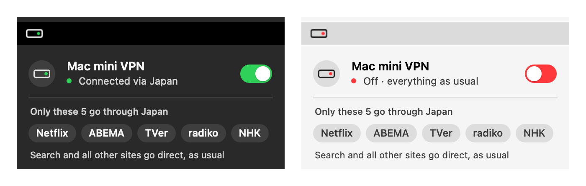

# Mac mini VPN

A menu-bar switch for Macs abroad. It sends just five Japanese video sites (Netflix, ABEMA, TVer, radiko and NHK) through a Mac at home in Japan. Everything else goes direct, as usual.



- **One switch.** Click the Mac mini icon in the menu bar. The lamp is green when it's on, red when it's off and orange when there's a problem.
- **Only the listed sites go through Japan.** Search, mail, work apps and everything else stay on your normal connection. The site list is one small file, [`pac/jp.pac`](pac/jp.pac).
- **The exit is a home line, not a data centre.** Japanese streaming services refuse addresses that belong to hosting companies and to commercial VPNs. A Mac on an ordinary home connection in Japan is just a home connection.
- **It keeps itself working.** A background job keeps the tunnel open, repairs it when it drops and never cuts a video that's playing. The health shown in the menu is ABEMA's own answer to "is this Japan?", not merely "connected".
- **Free.** You need two Macs, and everything else is free: [Tailscale](https://tailscale.com) (free plan), ssh, and optionally [kcptun](https://github.com/xtaci/kcptun).

## How it works

```
your browser ── jp.pac ─┬─ Netflix / ABEMA / TVer / radiko / NHK ─→ 127.0.0.1:1082 (ssh -D)
                        │        ─→ kcptun (UDP + error correction) ─→ Tailscale ─→ the Mac in Japan
                        └─ everything else ─────────────────────────→ direct, as usual
```

- **`jp.pac`** is a proxy auto-config file. It lists the sites, plus the domains their video actually streams from: ABEMA streams from `akamaized.net`, and Netflix from its own CDN. Sign-in and payment pages of these services stay direct. Netflix is the exception: all of its hosts go through the same exit, because Netflix refuses a session that signs in from one country and plays from another (error M7037).
- **`mmvpn-tunnel`** keeps `ssh -D` open to the Mac in Japan. It tries kcptun first, then plain ssh, then an optional relay host, and it repairs the tunnel by itself.
- **kcptun** carries the ssh connection over UDP with forward error correction. A long path between continents loses packets, and TCP slows down sharply when it does. On one such path, plain ssh gave 0.5–6 Mbit/s and ssh inside kcptun gave 11.6–19 Mbit/s. Netflix played in 1080p. kcptun is optional (`USE_KCP="no"`).
- **Only one setting on your Mac changes**: the automatic proxy configuration URL, on every network service. Turning it off clears that setting. The routing table and DNS are never touched, and no other app is affected.

## What you need

- **The Mac in Japan.** It must stay on and awake. Ethernet is strongly recommended (see the tips below).
- **The Mac you travel with.** It needs macOS 13 or later and the Xcode Command Line Tools (`xcode-select --install`).
- **Tailscale on both Macs**, signed in to the same account. Any other way of reaching the home Mac by ssh also works.
- **Optional, for speed:** [Homebrew](https://brew.sh) and `brew install kcptun` on both Macs.

## Setup

### 1. On the Mac in Japan (once)

1. Install Tailscale and sign in.
2. Go to **System Settings › General › Sharing** and turn on **Remote Login**.
3. Go to **System Settings › Energy** and turn on **Prevent automatic sleeping when the display is off** and **Start up automatically after a power failure**.
4. For kcptun, run:
   ```sh
   brew install kcptun
   git clone https://github.com/tomarai85/macmini-vpn.git
   cd macmini-vpn/home && ./install-home.sh
   ```
   It asks for the Mac's password once. It runs kcptun at every boot, even when nobody is logged in, and lets it through the macOS firewall.

You can do all of this remotely over Screen Sharing once Tailscale is running.

### 2. On the Mac you travel with

1. Install Tailscale and sign in with the same account.
2. Let ssh in without a password, then check that it works:
   ```sh
   ssh-copy-id user@100.x.y.z       # the home Mac's user name and Tailscale address
   ssh user@100.x.y.z true          # must return without asking for a password
   ```
3. Install:
   ```sh
   brew install kcptun              # skip if you use USE_KCP="no"
   git clone https://github.com/tomarai85/macmini-vpn.git
   cd macmini-vpn && ./install.sh
   ```
   The first run writes `~/.config/macmini-vpn/config` and stops. Set `HOME_MAC="user@100.x.y.z"` in it, then run `./install.sh` again.
4. Click the Mac mini icon in the menu bar and turn the switch on.

## Use

The menu-bar switch is the normal way to use it. The same controls also work from a terminal:

```sh
~/.local/bin/mmvpn up       # waits until the exit answers from Japan, then turns routing on
~/.local/bin/mmvpn down     # routing off, tunnel stopped
~/.local/bin/mmvpn status
```

Routing goes on only after the exit has answered from Japan. With routing on and no exit, the five sites would fail while everything else worked.

The app and the tunnel start again by themselves after a restart. **Quit** in the menu closes only the icon. Routing stays as it was.

**To add a site**, add its domain to `jp` in `pac/jp.pac` and run `./install.sh` again. If its video comes from a different domain, add that domain to `media` too. Your browser's developer tools show which domains the video loads from.

## Tips

- **Put the home Mac on Ethernet.** This makes the biggest difference. In one home the Mac was on a busy Wi-Fi channel, and the round trip to its own router averaged 250–330 ms and peaked at 3 s. Every new connection to the Japanese sites took 1.3–1.8 s, while every other site stayed fast.
- **"Not seen as Japan"** means the exit answers, but ABEMA doesn't accept it as Japan. Check that the home Mac isn't itself on a VPN.
- **"Home Mac not responding"** means the home Mac is off, asleep or offline, or that ssh asks for a password. Try `ssh user@address true`.
- Logs are in `~/.config/macmini-vpn/logs/`. The tunnel logs every route it tries.

## Uninstall

```sh
./uninstall.sh            # turns routing off, removes the app, scripts and launch agents (keeps your config)
./uninstall.sh --all      # also removes ~/.config/macmini-vpn
home/uninstall-home.sh    # on the Mac in Japan
```

## Other ways to do this

- **[Tailscale exit node](https://tailscale.com/kb/1103/exit-nodes).** The simplest setup: make the home Mac an exit node and turn it on wherever you are. It works on an Apple TV too. The drawback is that *all* traffic goes through Japan, so everything else gets slower too, and every site sees you as in Japan.
- **Tailscale App Connectors.** These route chosen domains through a connector node, but the connector has to run on Linux.
- **[Proxy Switchboard](https://ptrinh.github.io/proxy-switchboard-dist/).** The closest app to this one: per-site rules over SSH, SOCKS5, WireGuard and more, with failover and a menu-bar switch. You write the rules and set up the home end yourself.
- **[Clash Verge Rev](https://github.com/clash-verge-rev/clash-verge-rev) and ClashX Meta.** Rule-based proxy clients with a menu-bar toggle. You bring the server and the tunnel.
- **`ssh -D` plus a browser proxy extension.** The classic do-it-yourself setup. Nothing keeps the tunnel up, and it doesn't cope with a lossy long-distance path.
- **Your home router's VPN server.** Many Japanese routers have one (L2TP/IPsec). It routes the whole device and needs the router's admin settings.

What Mac mini VPN adds is the ready-made part. It comes with the list of Japanese video hosts, including the ones the video actually streams from. It sets up the home end, uses kcptun for a lossy path between continents, and checks the exit by asking ABEMA rather than by "connected". It turns on only when that check passes.

## A note on terms

Each streaming service decides where its content may be watched, and some limit viewing to the country of your account. Read the terms of the services you use. You are responsible for how you use this tool.

## Tests

```sh
bash tests/run.sh
```

The tests never change your proxy setting or start a real tunnel. The scripts run against stubs, and the app is built into a temporary folder. They cover:
- the PAC's routing, including look-alike hosts and shared CDNs;
- turning on only when the exit answers from Japan;
- the tunnel's route choice: fallback, recovery, never cutting a playing video;
- the installer;
- the app's own checks.

## Credits and license

MIT, see [LICENSE](LICENSE). The icon is drawn from the geometry of [Phosphor Icons](https://github.com/phosphor-icons/core)' `hard-drive` (MIT, Copyright (c) 2023 Phosphor Icons). The tunnel uses [kcptun](https://github.com/xtaci/kcptun) (MIT) when it's installed.
